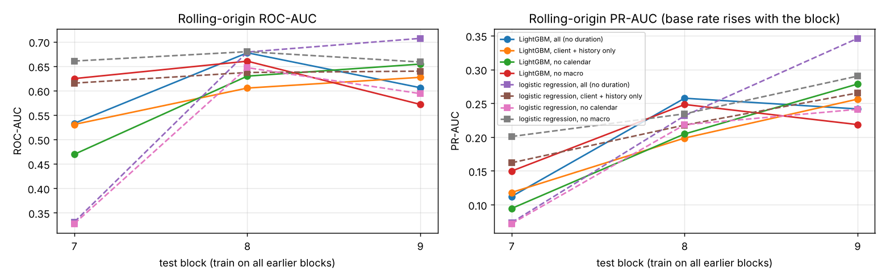
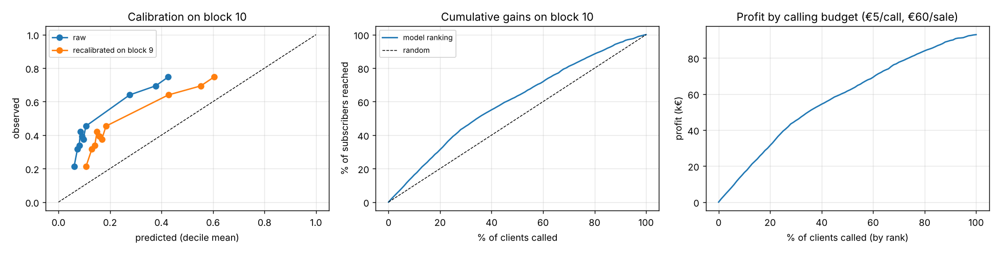

# Who should the bank call? Leakage, regime change and decisions on UCI Bank Marketing

[](https://colab.research.google.com/github/Ashhar-Hussain/bank-marketing-decision-ml/blob/main/bank_marketing_decision_ml.ipynb)
   

A Portuguese bank phoned 41,188 clients between May 2008 and November 2010 to sell term deposits ([Moro et al., 2014](https://doi.org/10.1016/j.dss.2014.03.001)). Tutorials on this dataset routinely report ROC-AUC around 0.93–0.95. This notebook shows where that number comes from, builds the model the bank could actually use *before* dialling, and turns it into a calling policy.

## What I found

| Question | Result |
|---|---|
| How much of the headline score is leakage? | ROC-AUC **0.950** with `duration` (known only after the call) on a random split → **0.805** without it → **0.680** when later calls are predicted from earlier ones |
| Which model survives the regime change? | Chosen on rolling-origin windows (blocks 7–9), a spline **logistic regression without macro features** beat LightGBM on the untouched final period: ROC-AUC 0.684 vs 0.621 (paired bootstrap difference +0.063, 95% CI +0.049 to +0.077); LightGBM with every feature: 0.638 |
| Can the probabilities be trusted? | No: the success rate jumped from ~7% to 46%; raw probabilities averaged 0.167. Recalibrating on the most recent block moved them to 0.262 and cut the Brier score from 0.308 to 0.261 |
| What does miscalibration cost? | At €5 per call and €60 per sale, thresholding the raw probabilities lost **€16,060** of profit in the final period; the recalibrated rule recovered it |




## Method

* **Data audit**: duplicates, `unknown` categories, the `pdays = 999` sentinel, target drift against the 3-month Euribor.
* **Protocol**: ten chronological blocks; feature sets and models compared with rolling-origin evaluation on blocks 7–9; Optuna (TPE) tuning on the same windows; block 10 touched once.
* **Models**: one-hot + spline logistic regression; LightGBM with native categorical handling.
* **Uncertainty**: paired bootstrap over calls (2,000 resamples) for every comparison.
* **Decisions**: Platt recalibration on the latest labelled block, cumulative gains, profit by calling budget, cost sensitivity.
* **Explainability**: coefficients and segment-level error analysis (age band, contact type, previous outcome).

## Run it

Open the notebook in Colab with the badge above and choose *Runtime → Run all* (CPU is enough, about 4 minutes), or locally:

```bash
pip install -r requirements.txt
jupyter nbconvert --to notebook --execute bank_marketing_decision_ml.ipynb
```

The data are downloaded from the [UCI Machine Learning Repository](https://archive.ics.uci.edu/dataset/222/bank+marketing) (CC BY 4.0) on first run.

## Repository

```
bank_marketing_decision_ml.ipynb    analysis, figures and findings (executed)
outputs/figures/                      figures used in this README
outputs/summary.json                  every number quoted above
outputs/findings.md                   findings as generated by the notebook
```

## Citation

If this analysis is useful to you, please cite it (GitHub shows a *Cite this repository* button from `CITATION.cff`):

```bibtex
@software{hussain2026bankmarketingdecis,
  author  = {Hussain, Ashhar},
  title   = {Who should the bank call? Leakage, regime change and decisions on UCI Bank Marketing},
  year    = {2026},
  url     = {https://github.com/Ashhar-Hussain/bank-marketing-decision-ml},
  version = {1.0.0}
}
```

## License

Code: MIT. Data: UCI Bank Marketing, CC BY 4.0.
